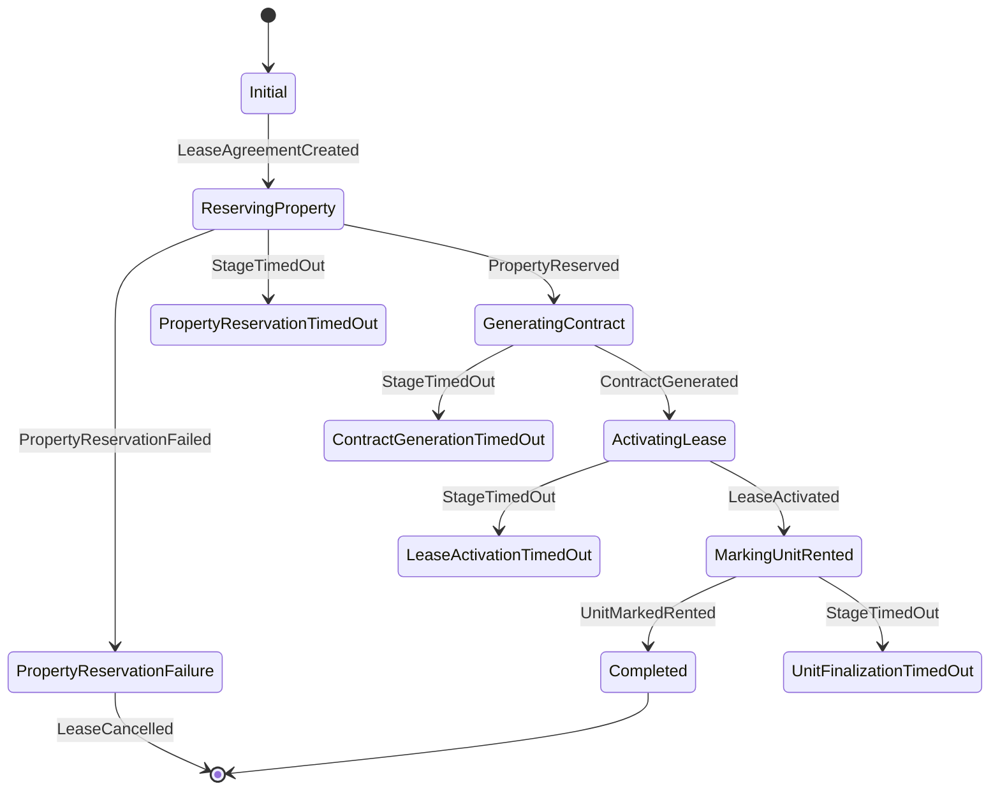

# ADR 003: Dağıtık İşlemler ve Saga Orkestrasyon Mimarisi

## Durum
**Kabul Edildi (Accepted) / Uygulandı (Implemented)**

## Tarih
2026-10-18

## Bağlam ve Sorun Tanımı (Context)
RentFlow sisteminde bir kira sözleşmesinin oluşturulması veya sonlandırılması, birden fazla bağımsız mikroservisin ve farklı veritabanı motorlarının (SQL Server, MongoDB, MinIO vb.) koordineli biçimde çalışmasını zorunlu kılar.

Örnek olarak bir kira sözleşmesi oluşturma sürecinde:
1. `LeaseService` (SQL Server) sözleşme taslağını oluşturur.
2. `PropertyService` (MongoDB) ilgili mülk birimini rezerve etmeli ve başka kiralamalara kapatmalıdır.
3. `DocumentService` (SQL Server / MinIO) resmi kira kontratı PDF belgesini üretmeli ve depolamalıdır.
4. `LeaseService` sözleşmeyi `ACTIVE` durumuna getirmelidir.
5. `PropertyService` mülk birimini kalıcı olarak `RENTED` olarak işaretlemelidir.

Bu adımlardan herhangi biri başarısız olduğunda (örneğin mülk o anda müsait değilse veya PDF üretiminde hata alınırsa) sistemin tutarsız bir durumda (inconsistent state) kalmaması, rezerve edilmiş mülkün serbest bırakılması ve sözleşmenin iptal edilmesi gerekir. Geleneksel 2PC (Two-Phase Commit) veya XA dağıtık işlemleri, yüksek ağ gecikmesi, kilitlenmeler (distributed deadlocks) ve ölçeklenebilirlik kısıtları nedeniyle mikroservis mimarisinde uygulanamaz.

## Karar (Decision)
Dağıtık işlem yönetimi için **Orkestrasyon Tabanlı Saga Deseni (Orchestration-based Saga Pattern)** seçilmiştir.

Orkestratör olarak **MassTransit State Machine (Automatonymous)** kullanılmış ve bağımsız `SagaOrchestrator` mikroservisi hayata geçirilmiştir.

### 1. Tanımlanan Saga Durum Makineleri

#### A. LeaseAgreementSaga (Kira Sözleşmesi Oluşturma)
Kira sözleşmesinin uçtan uca güvenli oluşturulmasını yönetir:
- **Tetikleyici Event:** `ILeaseAgreementCreatedEvent` (LeaseService yayınlar).
- **Adım 1:** `IReservePropertyCommand` komutunu PropertyService'e gönderir -> `ReservingProperty` durumuna geçer.
- **Adım 2:** PropertyService'ten `IPropertyReservedEvent` gelirse -> `IGenerateLeaseContractCommand` komutu DocumentService'e iletilir -> `GeneratingContract` durumuna geçer.
- **Adım 3:** DocumentService'ten `ILeaseContractGeneratedEvent` gelirse -> `IActivateLeaseCommand` komutu LeaseService'e iletilir -> `ActivatingLease` durumuna geçer.
- **Adım 4:** LeaseService'ten `ILeaseActivatedEvent` gelirse -> `IMarkUnitRentedCommand` komutu PropertyService'e iletilir -> `MarkingUnitRented` durumuna geçer.
- **Adım 5:** PropertyService'ten `IUnitMarkedRentedEvent` gelirse -> `Completed` durumuna geçer.
- **Telafi Edici İşlemler (Compensating Transactions):**
  - Mülk rezerve edilemezse (`IPropertyReservationFailedEvent`), derhal `ILeaseCancelledEvent` yayınlanarak sözleşme iptal edilir ve durum `PropertyReservationFailure` olarak işaretlenir.
  - Gecikmeli gelen geç event'ler (late events) için mülk serbest bırakma mekanizması işletilir.
- **Zaman Aşımı Yönetimi (Timeouts):** `LeaseAgreementSagaTimeoutService` arka plan servisi periyodik olarak takılmış aşamaları denetler ve `LeaseAgreementSagaStageTimedOut` ile telafi sürecini başlatır.

#### B. LeaseTerminationSaga (Kira Sözleşmesi Sonlandırma ve Depozito İadesi)
- **Tetikleyici Event:** `LeaseTerminationRequestedEvent`.
- **Adım 1 (Hasar Tespiti):** `AssessDamageCommand` -> MaintenanceService hasar ve masraf raporlar -> `DamageAssessedEvent`.
- **Adım 2 (Depozito İadesi):** Hasar bedeli düşüldükten sonra net iade tutarı hesaplanır (`RefundAmount = DepositAmount - DamageCost`) -> `RefundDepositCommand` -> PaymentService iadeyi gerçekleştirir -> `DepositRefundedEvent`.
- **Adım 3 (Mülk Tahliyesi):** `ReleasePropertyCommand` -> PropertyService mülk birimini yeniden boşa çıkarır (`AVAILABLE`) -> `PropertyReleasedEvent`.
- **Adım 4:** `Completed` durumuna ulaşılır.

#### C. RentPaymentSaga (Kira Ödeme Takibi)
- `IRentPaymentCompletedEvent` veya `IRentPaymentFailedEvent` sonuçlarını terminal durumlara eşler; çift/tekrar eden bildirimlerin (duplicate events) sisteme mükerrer ödeme veya orkestrasyon kaydı açmasını engeller.

### 2. Durum Saklama ve Eşzamanlılık (Persistence & Concurrency)
- Saga durumları PostgreSQL üzerinde `SagaDbContext` aracılığıyla saklanır.
- Dağıtık ortamlarda yarış durumlarını (race conditions) önlemek için **Pesimistik Eşzamanlılık (Pessimistic Concurrency)** uygulanmıştır (`r.ConcurrencyMode = ConcurrencyMode.Pessimistic; r.UsePostgres();`). PostgreSQL `SELECT ... FOR UPDATE` kilidi sayesinde aynı sözleşme veya işlem için gelen ardışık event'ler sırayla ve güvenle tüketilir.

### 3. Gözlemlenebilirlik (Observability)
- `SagaOrchestrator` Prometheus için özel metrikler üretir:
  - `saga_completed_total{saga_type}`
  - `saga_failed_total{saga_type}`
  - `saga_duration_seconds{saga_type}`
- Sistem yöneticileri için `GET /api/sagas` uç noktası üzerinden devam eden ve tamamlanan saga durumları listelenebilir.

## Sonuçlar ve Değerlendirme (Consequences)

### Olumlu Etkiler (Positive)
- **Nihai Tutarlılık (Eventual Consistency):** Farklı servis ve veritabanlarına yayılan işlemler, hata anında telafi komutlarıyla daima tutarlı bir duruma getirilir.
- **Korelasyon ve İzlenebilirlik:** Tüm komut ve event'ler `CorrelationId` (Guid) taşır; akış uçtan uca Zipkin ve OpenTelemetry üzerinde tek bir trace olarak incelenebilir.
- **Zaman Aşımı Güvencesi:** Asılı kalan işlemler (servis çökmesi vb.) otomatik olarak zaman aşımına uğratılıp telafi edilir.

### Olumsuz Etkiler ve Yönetilen Riskler (Trade-offs)
- **Geçici Durum Tutarsızlığı:** Sözleşme oluşturma anında milisaniyeler düzeyinde bir gecikme oluşur; kullanıcı arayüzü (Angular) bu durumu reactive yüklenme durumları ile kullanıcıya bildirir.
