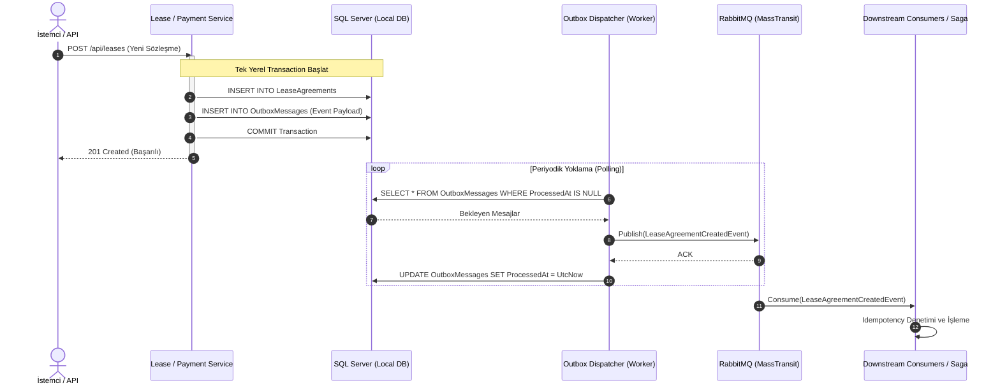

# ADR 004: Olay Güdümlü Mimari ve Transactional Outbox Deseni

## Durum
**Kabul Edildi (Accepted) / Uygulandı (Implemented)**

## Tarih
2026-10-18

## Bağlam ve Sorun Tanımı (Context)
Mikroservisler arası asenkron iletişim, sistemin gevşek bağlı (loosely coupled) kalmasını ve yüksek ölçeklenebilirlik sağlamasını temin eder. Ancak dağıtık sistemlerde **"İkili Yazma Problemi" (Dual-Write Problem)** en sık karşılaşılan veri tutarsızlığı kaynağıdır:

Bir iş akışında (örneğin kira ödemesi veya sözleşme kaydı):
1. Veri yerel veritabanına kaydedilir (`DbContext.SaveChangesAsync()`).
2. Ardından mesaj kuyruğuna (RabbitMQ) olay fırlatılır (`PublishAsync()`).

Bu yaklaşımda:
- Veritabanı yazımı başarılı olup kuyruk bağlantısı koparsa; olay iletilemez ve diğer mikroservisler işlemden haberdar olamaz (Silent Failure).
- Olay kuyruğa iletilip veritabanı `commit` aşamasında hata verirse; hayali bir işlem için diğer servisler tetiklenir (Phantom Event).

Dağıtık 2PC işlemleri kullanılamayacağına göre, yerel veritabanı kaydı ile mesaj yayınlama eyleminin atomik (hepsi ya da hiçbiri) biçimde gerçekleşmesi zorunludur.

## Karar (Decision)

1. **Mesajlaşma Omurgası: RabbitMQ ve MassTransit:**
   Mikroservisler arasındaki tüm asenkron olaylar ve saga komutları için **RabbitMQ 3 (Management)** mesaj broker'ı ve .NET tarafında **MassTransit 8.3** soyutlama kütüphanesi seçilmiştir.
   - Servisler arası doğrudan HTTP çağrıları yalnızca anlık okuma/lookup ihtiyaçları ile sınırlandırılmış; durum değiştiren tüm operasyonlar olay güdümlü (event-driven) hale getirilmiştir.

2. **Transactional Outbox Deseni (Transactional Outbox Pattern):**
   Kritik veri mutasyonlarının gerçekleştiği servislerde (`LeaseService`, `PaymentService` vb.) Transactional Outbox deseni uygulanmıştır:
   - İş nesnesi (`LeaseAgreement`, `PaymentTransaction`) kaydedilirken, yayılması gereken event nesnesi de serialize edilerek aynı veritabanı işlemi (`IDbContextTransaction`) dahilinde `OutboxMessages` tablosuna yazılır.
   - Bu sayede veritabanı düzeyinde atomik garanti sağlanır: Varlık kaydedilmezse outbox mesajı da kaydedilmez; varlık kaydedilirse outbox mesajı garanti altındadır.

3. **Outbox Dispatcher Arka Plan İşleyicisi:**
   - Her servis bünyesinde çalışan arka plan işleyicisi (`LeaseOutboxDispatcher`, `PaymentOutboxDispatcher`), periyodik olarak henüz işlenmemiş (`ProcessedAt IS NULL`) outbox kayıtlarını okur.
   - Mesajları RabbitMQ üzerinden MassTransit ile yayınlar.
   - Başarılı yayının ardından ilgili kaydın `ProcessedAt` alanını günceller ve transaction'ı tamamlar.
   - Olası broker kesintilerinde mesajlar veritabanında güvende kalır ve broker ayağa kalktığında kaldığı yerden iletilmeye devam eder.

4. **At-Least-Once İletim ve Idempotent Tüketim:**
   - Outbox deseni doğası gereği "en az bir kez iletim" (at-least-once delivery) garantisi sunar.
   - Mesaj tüketicileri (Consumers), aynı mesajın ağ gecikmesi veya tekrar deneme nedeniyle iki kez gelmesi ihtimaline karşı **Idempotent** olarak tasarlanmıştır:
     - Tüketici servisler işlem öncesi `CorrelationId`, `PaymentId` veya `LeaseId` kontrolü yapar.
     - Örneğin `RentPaymentSaga` zaten terminal durumdaki bir ödeme için gelen mükerrer event'leri yok sayar (`Ignore(PaymentCompleted)`).
     - `ReportService` projeksiyonları varlık ID'lerini anahtar olarak kullanır ve eski zaman damgalı tekrarları yoksayar.

## Uygulama Detayları

## Sonuçlar ve Değerlendirme (Consequences)

### Olumlu Etkiler (Positive)
- **Sıfır Veri Kaybı (Zero Data Loss):** Broker kapalı olsa dahi API istekleri başarıyla tamamlanır; broker açıldığında tüm olaylar sırasıyla iletilir.
- **Dual-Write Riskinin Ortadan Kalkması:** Dağıtık işlem kilitlerine ihtiyaç kalmaksızın %100 yerel ACID güvencesi elde edilir.
- **Dayanıklılık (Resilience):** RabbitMQ çökmesi sistemin ana işleyişini durdurmaz; mesajlar veritabanında birikir ve toparlanma sonrası boşaltılır.

### Olumsuz Etkiler ve Yönetilen Riskler (Trade-offs)
- **Mesaj İletim Gecikmesi (Eventual Latency):** Outbox polling aralığına bağlı olarak olayların yayınlanmasında küçük bir gecikme (100ms - 1s) olabilir.
- **Veritabanı Yükü ve Tablo Büyümesi:** `OutboxMessages` tablosu zamanla büyüyeceği için işlenmiş eski kayıtların periyodik olarak temizlenmesi veya arşivlenmesi gerekir.
