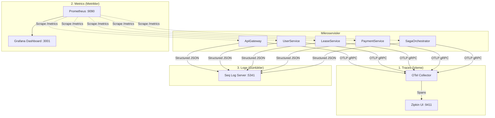

# ADR 010: Kapsamlı Gözlemlenebilirlik, Dağıtık İzleme ve Telemetri Mimarisi

## Durum
**Kabul Edildi (Accepted) / Uygulandı (Implemented)**

## Tarih
2026-10-18

## Bağlam ve Sorun Tanımı (Context)
Mikroservis mimarisinde tek bir kullanıcı işlemi (örneğin "Sözleşme Başlat" veya "Kira Öde") onlarca farklı container, ağ sıçraması (network hop), kuyruk mesajı ve veritabanı sorgusundan geçer.

Böylesi dağıtık bir sistemde merkezi ve standart bir gözlemlenebilirlik (observability) mimarisi bulunmadığında:
- Bir hata veya performans darboğazı yaşandığında hatanın hangi serviste, kuyrukta veya veritabanında meydana geldiği tespit edilemez.
- Her servisin log formatı farklı olur ve loglar container'lar içinde kaybolur.
- Dağıtık işlemlerin (Saga) ne kadar sürdüğü ve nerede takıldığı ölçülemez.

Gözlemlenebilirliğin üç temel direği olan **İzler (Traces)**, **Metrikler (Metrics)** ve **Günlükler (Logs)** eksiksiz ve birbiriyle ilişkili biçimde kurulmalıdır.

## Karar (Decision)

1. **Dağıtık İzleme (Distributed Tracing): OpenTelemetry & Zipkin:**
   - Standart vendor-neutral standart olan **OpenTelemetry (OTel)** seçilmiştir.
   - `SharedKernel.Tracing` altında `AddCustomOpenTelemetry` uzantısı geliştirilmiştir:
     - `AspNetCoreInstrumentation`: Tüm gelen HTTP isteklerini izler ve hata anında exception bilgilerini span'e ekler.
     - `HttpClientInstrumentation`: Servisler arası giden tüm HTTP isteklerine W3C TraceContext başlıklarını (`traceparent`, `tracestate`) ekler.
     - `AddSource("MassTransit")`: RabbitMQ üzerinden geçen tüm mesaj yayınlama ve tüketim adımlarını trace bağına bağlar.
   - Mikroservisler telemetri verilerini OTLP (gRPC/HTTP) protokolü üzerinden **OpenTelemetry Collector** (`otel-collector:4317`) bileşenine iletir.
   - OTel Collector, span'leri toplayıp **Zipkin** (`http://localhost:9411`) arayüzüne aktarır. Geliştiriciler tek bir `TraceId` ile işlemin Gateway -> Servis -> Kuyruk -> Saga zincirindeki tüm adımlarını milisaniye bazında görebilir.

2. **Metrik Toplama ve Görselleştirme: Prometheus & Grafana:**
   - Tüm servislerde `prometheus-net.AspNetCore` aktif edilerek `/metrics` uç noktası açılmıştır.
   - **Prometheus** (`http://localhost:9090`), her 15 saniyede bir tüm mikroservisleri scrape eder (Bkz: `infrastructure/prometheus/prometheus.yml`).
   - `SharedKernel.Metrics.AppMetrics` altında sisteme özel iş metrikleri tanımlanmıştır:
     - `saga_completed_total{saga_type}`
     - `saga_failed_total{saga_type}`
     - `saga_duration_seconds{saga_type}` (Histogram)
     - `redis_cache_hits_total`, `redis_cache_misses_total`
     - `redis_lock_acquired_total`, `redis_lock_failed_total`
   - **Grafana** (`http://localhost:3001`), otomatik provision edilmiş veri kaynakları ve hazır panolarla (`redis-performance.json`) sistemin canlı nabzını tutar.

3. **Yapılandırılmış Merkezi Loglama (Structured Logging): Seq:**
   - Serilog / Microsoft.Extensions.Logging ile JSON formatında yapılandırılmış (structured) loglar üretilir.
   - Loglar **Seq** (`http://localhost:5341`) sunucusuna iletilerek filtreleme, sorgulama ve alarm üretimi sağlanır. Her log kaydı `CorrelationId`, `Service`, `Environment` ve `TraceId` bilgileriyle zenginleştirilir.

4. **Sistem Sağlık Denetimi (Health Checks):**
   - Her mikroserviste `/health` uç noktası mevcuttur.
   - Servislerin bağlı olduğu SQL Server, PostgreSQL, MongoDB ve Redis kaynakları `AspNetCore.HealthChecks` kütüphaneleriyle düzenli olarak sorgulanır.

## Uygulama Detayları

## Sonuçlar ve Değerlendirme (Consequences)

### Olumlu Etkiler (Positive)
- **Hızlı Hata Tespiti (MTTR Azalması):** Yaşanan bir kiralama hatasında Zipkin üzerinde ilgili trace açılarak hangi serviste ne kadar beklendiği ve hatanın kaynağı saniyeler içinde bulunur.
- **Standart ve Taşınabilir:** OpenTelemetry kullanımı sayesinde ileride Zipkin yerine Jaeger, Datadog veya AWS X-Ray'e geçiş kod değişikliği gerektirmeden yalnızca config ile yapılabilir.
- **Proaktif İzleme:** Grafana ve Prometheus alarmları ile CPU, bellek veya başarısız saga sayısı eşik değerleri aştığında önceden uyarı alınabilir.

### Olumsuz Etkiler ve Yönetilen Riskler (Trade-offs)
- **Ekstra Container Kaynağı:** OTel Collector, Zipkin, Prometheus, Grafana ve Seq ortamda ~1 GB civarında ek RAM tüketir. Geliştirme ortamında bu araçlar isteğe bağlı kapatılabilir veya hafif modda çalıştırılabilir.
