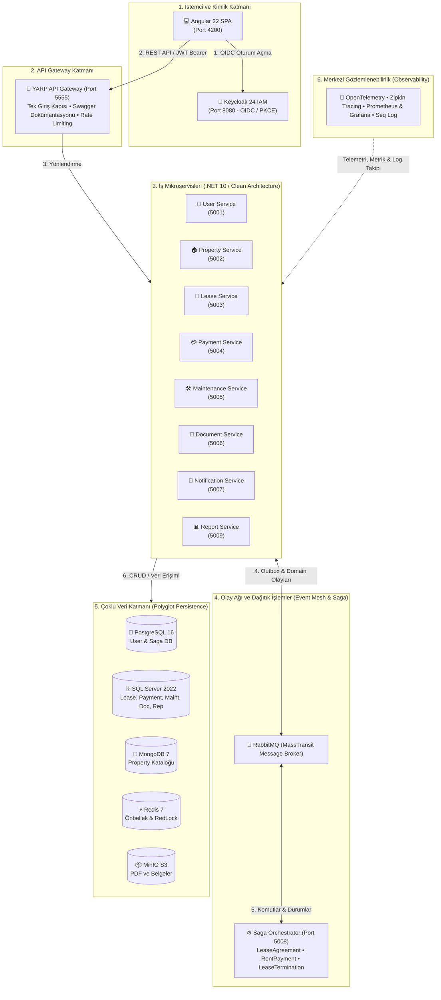

# 🏢 RentFlow — Akıllı ve Dağıtık Kira Yönetim Sistemi

[](https://dotnet.microsoft.com/)
[](https://angular.dev/)
[](https://www.docker.com/)
[](https://www.keycloak.org/)
[](https://www.rabbitmq.com/)
[](https://redis.io/)
[](https://www.postgresql.org/)
[](https://www.microsoft.com/sql-server)
[](https://www.mongodb.com/)
[](https://min.io/)
[](https://opentelemetry.io/)
[](https://prometheus.io/)
[](https://grafana.com/)

**RentFlow**, gayrimenkul sahipleri (*Landlord*), kiracılar (*Tenant*) ve platform yöneticilerini (*Admin*) modern, güvenli ve yüksek performanslı bir dijital ekosistemde buluşturan **kurumsal ölçekli bir akıllı kira yönetim platformudur**.

Geleneksel emlak yönetimindeki elle sözleşme hazırlama, geciken kira takipleri, kaybolan dekontlar, kayıt altına alınamayan tadilat/bakım talepleri ve karmaşık muhasebe süreçlerini; **Domain-Driven Design (DDD)**, **Clean Architecture**, **Saga Dağıtık İşlem Orkestrasyonu**, **Transactional Outbox Deseni** ve **Çoklu Veritabanı (Polyglot Persistence)** yaklaşımlarıyla tamamen otomatikleştirir.

---

## 📌 İçindekiler
1. [Sistem Mimarisi ve Topoloji](#-sistem-mimarisi-ve-topoloji)
2. [Mikroservis Envanteri ve Port Matrisi](#-mikroservis-envanteri-ve-port-matrisi)
3. [Temel Mimari İlkeler ve Tasarım Kalıpları](#-temel-mimari-ilkeler-ve-tasarım-kalıpları)
   - [Domain-Driven Design (DDD) ve Clean Architecture](#1-domain-driven-design-ddd-ve-clean-architecture)
   - [Saga Deseni ve Dağıtık İşlem Orkestrasyonu](#2-saga-deseni-ve-dağıtık-işlem-orkestrasyonu)
   - [Olay Güdümlü Mimari ve Transactional Outbox](#3-olay-güdümlü-mimari-ve-transactional-outbox)
   - [Çoklu Veritabanı Stratejisi (Polyglot Persistence)](#4-çoklu-veritabanı-stratejisi-polyglot-persistence)
   - [CQRS ve Olay Tabanlı Raporlama Projeksiyonları](#5-cqrs-ve-olay-tabanlı-raporlama-projeksiyonları)
   - [Merkezi Kimlik ve Güvenlik (Keycloak & OIDC)](#6-merkezi-kimlik-ve-güvenlik-keycloak--oidc)
   - [API Gateway (Microsoft YARP) ve Swagger Birleştirme](#7-api-gateway-microsoft-yarp-ve-swagger-birleştirme)
   - [Kapsamlı Gözlemlenebilirlik (OpenTelemetry, Zipkin, Prometheus, Grafana, Seq)](#8-kapsamlı-gözlemlenebilirlik)
4. [Modern Frontend Mimarisi (Angular 22 & NgRx)](#-modern-frontend-mimarisi-angular-22--ngrx)
5. [Hızlı Başlangıç Kılavuzu](#-hızlı-başlangıç-kılavuzu)
6. [Önceden Tanımlı Demo Hesaplar](#-önceden-tanımlı-demo-hesaplar)
7. [Yönetim ve İzleme Arayüzleri Rehberi](#-yönetim-ve-izleme-arayüzleri-rehberi)
8. [Test ve Kalite Güvencesi](#-test-ve-kalite-güvencesi)
9. [Proje Dizin Yapısı](#-proje-dizin-yapısı)
10. [Mimari Karar Kayıtları (ADR Dizin)](#-mimari-karar-kayıtları-adr-dizin)

---

## 🏗 Sistem Mimarisi ve Topoloji

Sistem; istemcilerin doğrudan mikroservislere erişmesini engelleyen tek bir giriş kapısı (**YARP API Gateway**), asenkron haberleşmeyi koordine eden **RabbitMQ**, dağıtık işlemleri yürüten **Saga Orchestrator**, her biri kendi veritabanına sahip bağımsız iş servisleri ve tam teşekküllü bir telemetri yığınından oluşur.



---

## 📊 Mikroservis Envanteri ve Port Matrisi

| Servis Adı | Dış/İç Port | Veritabanı | Temel Sorumlulukları | Kullanılan Temel Teknolojiler |
|---|:---:|---|---|---|
| **ApiGateway** | `5555` / `80` | Yok | Tek dış erişim kapısı, ters dizin rotalama, merkezi Swagger agregasyonu, IP rate limiting, W3C trace yayılımı. | Microsoft YARP 2.3, JWT Bearer, OpenTelemetry |
| **UserService** | `5001` / `80` | PostgreSQL (`user_service_db`) | Keycloak kullanıcı senkronizasyonu, profil yönetimi (Landlord/Tenant), kiracı e-posta davetiye (`TenantInvitation`) yaşam döngüsü. | EF Core, PostgreSQL, Redis Cache, MediatR |
| **PropertyService** | `5002` / `80` | MongoDB (`property_service_db`) | Mülk ve bağımsız birimlerin (daire/dükkan) esnek niteliklerle kaydı, kiralama rezervasyon kontrolü, kiralandı/boş durum yönetimi. | MongoDB Driver, MassTransit RabbitMQ, Redis |
| **LeaseService** | `5003` / `80` | SQL Server (`lease_service_db`) | Kira sözleşmelerinin oluşturulması, yürürlüğe alınması, feshi; Transactional Outbox üzerinden olay yayımı. | EF Core 10, SQL Server, Transactional Outbox, Polly |
| **PaymentService** | `5004` / `80` | SQL Server (`payment_service_db`) | Kira ve depozito tahsilatları, iade süreçleri, Hangfire periyodik görevleri, Stripe ve Simulated ödeme sağlayıcıları. | EF Core, SQL Server, Hangfire, Outbox Dispatcher |
| **MaintenanceService**| `5005` / `80` | SQL Server (`MaintenanceDb`) | Kiracı arıza/tadilat talepleri, iş emri takibi, sözleşme sonlandırma hasar ekspertiz değerlendirmesi. | EF Core, SQL Server, MassTransit Consumers |
| **DocumentService** | `5006` / `80` | SQL Server (`DocumentDb`) + MinIO | Resmi PDF kira sözleşmesi ve ödeme makbuzlarının dinamik üretimi; MinIO (S3) üzerinde güvenli ikili nesne depolama. | QuestPDF, MinIO S3 SDK, EF Core, MassTransit |
| **NotificationService**| `5007` / `80` | SQL Server (`NotificationDb`) + Mailhog | E-posta (SMTP), SMS ve Push bildirim loglama ve asenkron şablonlu gönderim yönetimi. | MailKit, Simulated SMS/Push, MassTransit |
| **ReportService** | `5009` / `80` | SQL Server (`ReportDb`) | Mülk sahipleri için yıllık/aylık net gelir, doluluk ve tahsilat başarı istatistikleri için CQRS Read Model projeksiyonları. | CQRS, Read Models, MassTransit Consumers |
| **SagaOrchestrator** | `5008` / `80` | PostgreSQL (`saga_db`) | Dağıtık işlem durum makineleri (LeaseAgreement, RentPayment, LeaseTermination), pesimistik kilitleme, zaman aşımı ve telafi komutları. | MassTransit State Machine (Automatonymous), MediatR |
| **Frontend** | `4200` / `80` | LocalStorage / Keycloak | Kiracı, Ev Sahibi ve Yönetici panoları, reaktif formlar, finansal grafikler, dinamik çalışma zamanı ayarları. | Angular 22, NgRx Store & Effects, Chart.js, Playwright |

---

## 🧩 Temel Mimari İlkeler ve Tasarım Kalıpları

### 1. Domain-Driven Design (DDD) ve Clean Architecture
Her .NET mikroservisi **Clean Architecture** prensiplerine göre 4 katmana ayrılmıştır:
- **Domain:** Harici hiçbir kütüphaneye bağımlı olmayan `AggregateRoot`, `BaseEntity`, `IDomainEvent`, Değer Nesneleri (`ValueObjects`) ve saf iş mantığı.
- **Application:** CQRS desenine uygun `Commands`, `Queries`, `MediatR` işleyicileri, arayüz sözleşmeleri (`IRepository`, `IService`) ve DTO nesneleri.
- **Infrastructure:** `DbContext` tanımları, ORM yapılandırmaları, veritabanı migrasyonları, 3. parti HTTP istemcileri ve dış sağlayıcı implementasyonları.
- **API:** RESTful Controller'lar veya Minimal API'ler, Dependency Injection kayıtları, Global Exception Handling ve Swagger yapılandırmaları.

Ortak çekirdek kodlar (`Result<T>`, `PagedResult<T>`, `RentFlowAuthentication`, `IdempotencyFilter`) `SharedKernel` ve `SharedKernel.Primitives` projelerinde toplanmıştır.

📄 *Detaylı Mimari Karar:* [ADR 001: Mikroservis Mimarisi, DDD ve Clean Architecture](Proje%20Detaylar%C4%B1/ADRs/001-microservices-and-clean-architecture.md)

---

### 2. Saga Deseni ve Dağıtık İşlem Orkestrasyonu
Farklı veritabanlarına sahip mikroservisler arasında ACID garantisi sağlamak için 2PC yerine **Orkestrasyon Tabanlı Saga Deseni** uygulanmıştır. `SagaOrchestrator` servisinde çalışan 3 ana durum makinesi:

#### A. LeaseAgreementSaga (Kira Sözleşmesi Yaşam Döngüsü)
1. `LeaseService` sözleşme taslağını oluşturur ve `ILeaseAgreementCreatedEvent` fırlatır.
2. Saga, `PropertyService`'e `IReservePropertyCommand` gönderir (`ReservingProperty`).
3. Mülk rezerve edilince `DocumentService`'e `IGenerateLeaseContractCommand` iletilir (`GeneratingContract`).
4. PDF üretilince `LeaseService`'e `IActivateLeaseCommand` gönderilir (`ActivatingLease`).
5. Sözleşme aktifleşince `PropertyService`'e `IMarkUnitRentedCommand` gönderilir (`MarkingUnitRented`).
6. Daire "Kiralandı" olarak işaretlenince saga `Completed` durumuna geçer.
- **Telafi Komutları (Compensations):** Mülk müsait değilse veya PDF üretiminde hata alınırsa `ILeaseCancelledEvent` yayınlanır, rezerve edilmiş mülk serbest bırakılır ve sözleşme iptal edilir.
- **Zaman Aşımı Güvencesi:** `LeaseAgreementSagaTimeoutService` arka planda takılan adımları zaman aşımına uğratarak sistemin kilitlenmesini önler.

#### B. LeaseTerminationSaga (Sözleşme Feshi ve Depozito İadesi)
- `LeaseTerminationRequestedEvent` ile başlar.
- `MaintenanceService` hasar tespiti yapar (`AssessDamageCommand` -> `DamageAssessedEvent`).
- Net depozito hesaplanır (`DepositAmount - DamageCost`) ve `PaymentService` iadeyi işler (`RefundDepositCommand` -> `DepositRefundedEvent`).
- `PropertyService` mülkü yeniden boşa çıkarır (`ReleasePropertyCommand` -> `PropertyReleasedEvent`).

#### C. RentPaymentSaga (Ödeme Sonuç Takibi)
- `IRentPaymentCompletedEvent` veya `IRentPaymentFailedEvent` sonuçlarını terminal durumlara eşler; mükerrer gelen event'leri yok sayarak finansal idempotency sağlar.

📄 *Detaylı Mimari Karar:* [ADR 003: Dağıtık İşlemler ve Saga Orkestrasyon Mimarisi](Proje%20Detaylar%C4%B1/ADRs/003-distributed-transactions-saga-orchestrator.md)

---

### 3. Olay Güdümlü Mimari ve Transactional Outbox
Veritabanı kaydı ile RabbitMQ'ya mesaj gönderme eyleminin atomik gerçekleşmesini garanti etmek ve **Dual-Write** hatasını ortadan kaldırmak için **Transactional Outbox Deseni** uygulanmıştır:

1. İş nesnesi kaydedilirken ilgili domain event de serialize edilerek aynı yerel SQL transaction'ında `OutboxMessages` tablosuna yazılır.
2. Bağımsız `OutboxDispatcher` arka plan işleyicisi işlenmemiş mesajları periyodik olarak okur, RabbitMQ'ya iletir ve mesajı `ProcessedAt` ile işaretler.
3. RabbitMQ geçici olarak kapansa dahi hiçbir olay kaybolmaz; broker açıldığında iletim güvenle devam eder.

📄 *Detaylı Mimari Karar:* [ADR 004: Olay Güdümlü Mimari ve Transactional Outbox Deseni](Proje%20Detaylar%C4%B1/ADRs/004-event-driven-architecture-and-outbox-pattern.md)

---

### 4. Çoklu Veritabanı Stratejisi (Polyglot Persistence)
Her iş alanının veri doğasına en uygun veritabanı seçilmiştir:
- **PostgreSQL 16:** Kullanıcı kimlikleri, Keycloak IAM ve Saga durum makineleri (yüksek eşzamanlılık ve `SELECT FOR UPDATE` pesimistik kilitleme için optimize).
- **SQL Server 2022:** Sözleşmeler, finansal işlemler, arıza kayıtları ve raporlar (katı ACID bütünlüğü ve finansal denetlenebilirlik için).
- **MongoDB 7:** Mülk kataloğu (dinamik oda/daire özellikleri, değişken donanım listeleri ve esnek doküman şeması için).
- **MinIO (S3):** PDF kontratlar ve ödeme makbuzları gibi büyük ikili nesnelerin veritabanını şişirmesini engelleyen nesne depolama.
- **Redis 7:** Sık okunan profiller ve sözleşmeler için Cache-Aside önbellekleme ve dağıtık senkronizasyon.

📄 *Detaylı Mimari Karar:* [ADR 002: Çoklu Veri Depolama Stratejisi (Polyglot Persistence)](Proje%20Detaylar%C4%B1/ADRs/002-polyglot-persistence.md)  
📄 *Detaylı Mimari Karar:* [ADR 006: Redis Dağıtık Önbellekleme Stratejisi](Proje%20Detaylar%C4%B1/ADRs/006-redis-strategy.md)

---

### 5. CQRS ve Olay Tabanlı Raporlama Projeksiyonları
Mülk sahiplerinin gelir raporları `ReportService` tarafından **CQRS Read Model** mantığıyla üretilir. Senkron HTTP agregasyonları yerine; Lease, Payment, Property ve Maintenance servislerinden yayınlanan olaylar asenkron olarak tüketilir ve `ReportDb` üzerindeki projeksiyon tablolarına yazılır:
- Sorgular anlık (sub-50ms) sürede cevaplanır.
- Kaynak servisler kapalı olsa dahi raporlama kesintisiz hizmet verir.
- Henüz projeksiyonu tamamlanmamış mülkler için sahte "0 TL" dönülmez; HTTP 503 ve açıklayıcı RFC 7807 problem detayı döndürülür.

📄 *Detaylı Mimari Karar:* [ADR 008: CQRS ve Olay Güdümlü Raporlama Projeksiyonları](Proje%20Detaylar%C4%B1/ADRs/008-cqrs-and-reporting-projections.md)

---

### 6. Merkezi Kimlik ve Güvenlik (Keycloak & OIDC)
- **Kimlik Sağlayıcı (IdP):** Keycloak 24, kurumsal `rentflow` teması ve Google Identity Provider federasyonu.
- **Yetkilendirme Akışı:** SPA istemcisi için en güvenli akış olan **Authorization Code Flow with PKCE** (`angular-oauth2-oidc`).
- **Rol Tabanlı Erişim (RBAC):** `ROLE_ADMIN`, `ROLE_LANDLORD`, `ROLE_TENANT`, `ROLE_USER`.
- **Token Doğrulama:** Stateless RS256 JWT Bearer token'lar. API Gateway ve tüm servisler token dijital imzasını Keycloak JWKS genel anahtarıyla yerel olarak mikrosaniyeler içinde doğrular.

📄 *Detaylı Mimari Karar:* [ADR 005: Merkezi Kimlik ve Yetkilendirme Mimarisi (Keycloak & OIDC)](Proje%20Detaylar%C4%B1/ADRs/005-centralized-identity-and-access-management.md)

---

### 7. API Gateway (Microsoft YARP) ve Swagger Birleştirme
Dış dünyaya **Port 5555** üzerinden hizmet veren YARP Gateway:
- Tüm mikroservis REST rotalarını tek bir kapıda toplar (`/api/users`, `/api/properties`, `/api/leases`, `/api/payments`, vb.).
- `http://localhost:5555/swagger` adresinde tüm alt servislerin OpenAPI şemalarını birleştirerek tek bir interaktif test paneli sunar.
- Keycloak Bearer token yetkilendirmesini Swagger UI üzerinde kalıcı kılar (`EnablePersistAuthorization`).
- Dağıtık izleme için W3C TraceContext başlıklarını otomatik olarak downstream servislere aktarır.

📄 *Detaylı Mimari Karar:* [ADR 007: API Gateway ve Ters Dizin Mimarisi (Microsoft YARP)](Proje%20Detaylar%C4%B1/ADRs/007-api-gateway-and-reverse-proxy-yarp.md)

---

### 8. Kapsamlı Gözlemlenebilirlik
- **İzler (Traces):** OpenTelemetry SDK -> OTel Collector (4317) -> **Zipkin** (9411). Bir isteğin Gateway'den başlayıp RabbitMQ ve veritabanı sorgularına kadar olan tüm ömrü uçtan uca görselleştirilir.
- **Metrikler (Metrics):** Tüm servislerin `/metrics` uç noktaları **Prometheus** (9090) tarafından 15 saniyede bir taranır. **Grafana** (3001) üzerinde hazır panolarla canlı izlenir.
- **Loglar (Logs):** Tüm loglar `CorrelationId`, `Service` ve `TraceId` meta verileriyle zenginleştirilerek **Seq** (5341) yapılandırılmış log sunucusuna akar.
- **Sağlık Denetimi:** Her serviste `/health` uç noktası üzerinden veritabanı ve kuyruk bağlantıları denetlenir.

📄 *Detaylı Mimari Karar:* [ADR 010: Kapsamlı Gözlemlenebilirlik ve Telemetri Mimarisi](Proje%20Detaylar%C4%B1/ADRs/010-observability-telemetry-and-monitoring.md)

---

## 💻 Modern Frontend Mimarisi (Angular 22 & NgRx)

Frontend, `frontend/rent-management` altında yer alan modern bir **Angular 22 Standalone** uygulamasıdır:
- **Modüler Standalone Mimari:** `NgModule` kalabalığı olmaksızın hızlı yüklenen, lazy-load destekli bileşenler.
- **NgRx Reaktif Durum Yönetimi:** NgRx Store, Effects ve DevTools ile öngörülebilir ve izlenebilir state akışı.
- **Rol Tabanlı Rota Güvenliği:**
  - `rootRedirectGuard`: Kullanıcı rolüne göre anında `/tenant`, `/landlord` veya `/admin` paneline yönlendirir.
  - `authGuard` & `roleGuard`: Sayfa bazında Keycloak yetki kontrolü yapar.
- **Çalışma Zamanı Yapılandırması:** `assets/app-config.json` dosyası `APP_INITIALIZER` ile uygulama başlangıcında dinamik okunur; frontend container'ı yeniden derlenmeden farklı sunucu ortamlarına uyum sağlar.
- **Test Altyapısı:** Birim testler için **Vitest**, uçtan uca tarayıcı testleri için **Playwright** (`npm run test:e2e`).

📄 *Detaylı Mimari Karar:* [ADR 009: Modern Frontend Mimarisi (Angular 22 & NgRx)](Proje%20Detaylar%C4%B1/ADRs/009-modern-frontend-angular-ngrx.md)

---

## 🚀 Hızlı Başlangıç ve Kullanıcı Kurulum Kılavuzu

### ⚙️ Önkoşullar
- [Docker Desktop](https://www.docker.com/products/docker-desktop/) (Açık ve çalışır durumda olmalıdır)
- [.NET 10 SDK](https://dotnet.microsoft.com/) *(Yalnızca yerel kod geliştirme veya test çalıştırma için)*
- [Node.js 22 LTS](https://nodejs.org/) ve `npm` *(Yalnızca yerel Angular geliştirme için)*

---

### 1️⃣ Adım 1: Ortam Değişkenlerini Hazırlayın (.env)
Proje kök dizinindeki `.env.example` dosyasını kopyalayıp yerel makinenizde `.env` adıyla kaydedin:

```powershell
copy .env.example .env
```

`.env` dosyası içindeki veritabanı, broker ve servis şifrelerini belirleyin:
- `POSTGRES_PASSWORD`: PostgreSQL yönetici parolası
- `SA_PASSWORD`: SQL Server sistem yöneticisi (`sa`) parolası (en az 8 karakter, büyük/küçük harf, rakam ve sembol içermelidir)
- `MONGO_INITDB_ROOT_PASSWORD`: MongoDB root parolası
- `REDIS_PASSWORD`: Redis erişim parolası
- `KEYCLOAK_ADMIN_PASSWORD`: Keycloak ana yönetici parolası
- `RABBITMQ_DEFAULT_PASS`: RabbitMQ uygulama kullanıcısı parolası

> [!CAUTION]
> `.env` dosyası hassas parolalar içerir ve `.gitignore` ile Git takibinden çıkarılmıştır. **Bu dosyayı kesinlikle GitHub'a commit etmeyin veya paylaşmayın.**

---

### 2️⃣ Adım 2: Google ile Giriş (OAuth2) Yapılandırması *(İsteğe Bağlı)*
RentFlow, Keycloak üzerinden Google ile oturum açmayı (Social Login) destekler. Bu özelliği aktif hale getirmek için:

1. [Google Cloud Console](https://console.cloud.google.com/) adresine gidin.
2. **APIs & Services -> Credentials** menüsünden **Create Credentials -> OAuth client ID** seçeneğini tıklayın.
3. Uygulama türünü **Web Application** seçin.
4. **Authorized Redirect URIs (Yetkilendirilmiş Yönlendirme URI'leri)** alanına şu adresi ekleyin:
   ```text
   http://localhost:8080/realms/rent-management/broker/google/endpoint
   ```
5. Google tarafından verilen **Client ID** ve **Client Secret** bilgilerini:
   - Sistemi ilk kez başlatmadan önce [infrastructure/keycloak/realm-export.json](infrastructure/keycloak/realm-export.json#L34-L35) içindeki `YOUR_GOOGLE_CLIENT_ID` ve `YOUR_GOOGLE_CLIENT_SECRET` alanlarına yazabilir, **veya**
   - Sistem ayağa kalktıktan sonra [Keycloak Yönetici Konsolu](http://localhost:8080) -> **Identity Providers -> Google** menüsünden arayüz üzerinden kaydedebilirsiniz.

> [!NOTE]
> Google ile giriş özelliğini kullanmayacaksanız bu adımı atlayabilirsiniz; yerel demo e-posta ve şifreleriyle tüm sistem eksiksiz çalışır.

---

### 3️⃣ Adım 3: Demo Kullanıcı Parolalarını Belirleyin
Yerel geliştirme ve demo senaryoları için önceden hazırlanmış hesapların şifrelerini `.env` dosyası içinde tanımlayın:
```env
KEYCLOAK_DEMO_ADMIN_PASSWORD=GucluDemoSifresi1!
KEYCLOAK_DEMO_LANDLORD_PASSWORD=GucluDemoSifresi2!
KEYCLOAK_DEMO_TENANT_PASSWORD=GucluDemoSifresi3!
```
*Bu değerler `keycloak-demo-users-init` servisi tarafından yalnızca yerel geliştirme ortamında Keycloak kullanıcılarına atanır ve asla loglanmaz.*

---

### 4️⃣ Adım 4: Sistemi Başlatın
Tüm altyapıyı, veritabanlarını, mesaj kuyruğunu, mikroservisleri ve frontend'i tek bir komutla başlatabilirsiniz:

#### Seçenek A: Otomatik Başlatıcı Script (Windows)
```cmd
start-project.bat
```

#### Seçenek B: Docker Compose ile Doğrudan Başlatma
```powershell
# Eski container'ları temizle ve tüm stack'i ayağa kaldır
docker compose up -d --build --remove-orphans
```

Sistem başlatıldığında:
- PostgreSQL, SQL Server ve MongoDB veritabanları otomatik oluşturulur.
- MinIO üzerinde `documents` ve `images` bucket'ları otomatik açılır.
- Keycloak `rent-management` realm'i otomatik içe aktarılır.
- API Gateway ve 8 mikroservis derlenip çalıştırılır.
- Angular Frontend [http://localhost:4200](http://localhost:4200) üzerinde yayına başlar.

---

### 5️⃣ Adım 5: Örnek Veri Tohumlama (Seed Data)
Tüm sistem ayağa kalktıktan sonra (yaklaşık 30-45 saniye sonra), sisteme hazır mülkler, daireler, aktif kira sözleşmesi, ödeme geçmişi ve örnek PDF sözleşmesi yüklemek için PowerShell script'ini çalıştırın:

```powershell
powershell -ExecutionPolicy Bypass -File ./infrastructure/sample-data/seed-rental-demo.ps1
```

Bu script:
- Demo Ev Sahibi ve Kiracı profillerini doğrular,
- 2 adet örnek mülk ve 3 adet daire birimi oluşturur,
- Örnek bir aktif kira sözleşmesi (`30000000-0000-0000-0000-000000000001`) tanımlar,
- Geçmiş kira ödemelerini kaydeder,
- MinIO içine örnek bir kira kontratı PDF dosyası yükler.

---

### 🛡️ Güvenlik ve Üretim (Production) Kontrol Listesi
Projeyi canlıya alırken veya public repolarda paylaşırken dikkat edilmesi gereken temel kurallar:
- [x] `.env` dosyasını asla Git'e eklemeyin (`.gitignore` dosyasında `.env` kuralı mevcuttur).
- [x] Üretim ortamında `Payments__Mode=Simulated` yerine gerçek ödeme sağlayıcısı (`Stripe`) kullanın.
- [x] Üretim ortamında `Database__MigrateOnStartup=true` ayarını kapatın; migrasyonları `infrastructure/migrations/build-migration-bundles.ps1` ile derlenen paketlerle uygulayın.
- [x] Keycloak varsayılan `admin` parolasını ve veritabanı şifrelerini güçlü rastgele anahtarlarla değiştirin.

---

## 👥 Önceden Tanımlı Demo Hesaplar

Keycloak `rent-management` realm'inde önceden yapılandırılmış 3 farklı rol profili bulunmaktadır:

| Rol | E-Posta / Kullanıcı Adı | Şifre | Erişim Yetkisi |
|---|---|---|---|
| **Sistem Yöneticisi (Admin)** | `admin@demo.com` | `.env` içindeki `KEYCLOAK_DEMO_ADMIN_PASSWORD` | Admin Paneli (`/admin`), Saga akışları (`/api/sagas`), sistem metrikleri |
| **Mülk Sahibi (Landlord)** | `landlord@demo.com` | `.env` içindeki `KEYCLOAK_DEMO_LANDLORD_PASSWORD` | Ev Sahibi Paneli (`/landlord`), mülk ekleme, kontrat açma, gelir raporları |
| **Kiracı (Tenant)** | `tenant@demo.com` | `.env` içindeki `KEYCLOAK_DEMO_TENANT_PASSWORD` | Kiracı Paneli (`/tenant`), kira ödeme, dekont inceleme, arıza talebi açma |

> [!NOTE]
> Demo şifreleri `.env` dosyasında boş bırakılmışsa Keycloak Yönetici Konsolu (`http://localhost:8080`) üzerinden **Users -> Set Password** menüsünden şifre tanımlayabilirsiniz.

---

## 🖥 Yönetim ve İzleme Arayüzleri Rehberi

| Servis / Araç | URL | Varsayılan Kimlik Bilgileri | Açıklama |
|---|---|---|---|
| **RentFlow Web Uygulaması** | [http://localhost:4200](http://localhost:4200) | Demo kullanıcıları | Angular 22 kullanıcı arayüzü |
| **YARP API Gateway & Swagger** | [http://localhost:5555/swagger](http://localhost:5555/swagger) | Keycloak Bearer Token | Tüm mikroservislerin birleştirilmiş interaktif API dokümantasyonu |
| **Keycloak Yönetici Konsolu** | [http://localhost:8080](http://localhost:8080) | `admin` / `.env` şifresi | Realm, istemci, kullanıcı ve rol yönetimi |
| **Grafana Panoları** | [http://localhost:3001](http://localhost:3001) | `admin` / `.env` şifresi | Sistem metrikleri ve Redis performans panoları |
| **Seq Yapılandırılmış Loglar** | [http://localhost:5341](http://localhost:5341) | `Admin123!` | Gerçek zamanlı filtreli mikroservis logları |
| **Zipkin Dağıtık İzleme** | [http://localhost:9411](http://localhost:9411) | Şifresiz | Uçtan uca HTTP ve RabbitMQ trace analizi |
| **Prometheus Metrik Sunucusu** | [http://localhost:9090](http://localhost:9090) | Şifresiz | Ham metrik sorgulama ve alarm durumu |
| **RabbitMQ Yönetim Paneli** | [http://localhost:15672](http://localhost:15672) | `.env` kullanıcısı ve şifresi | Kuyruklar, exchange'ler ve mesaj akışı |
| **MinIO Konsolu** | [http://localhost:9001](http://localhost:9001) | `.env` root kullanıcısı | PDF sözleşmeler ve medya bucket yöneticisi |
| **Mailhog (SMTP Web UI)** | [http://localhost:8025](http://localhost:8025) | Şifresiz | Gönderilen test e-postalarını inceleme |
| **pgAdmin (PostgreSQL GUI)** | [http://localhost:5050](http://localhost:5050) | `admin@rent.com` / `.env` şifresi | PostgreSQL veritabanı yönetim arayüzü |
| **RedisInsight** | [http://localhost:8001](http://localhost:8001) | Şifresiz / Redis pass | Redis key-value tarayıcısı ve bellek analizi |

---

## 🧪 Test ve Kalite Güvencesi

Proje, Domain katmanından uçtan uca tarayıcı senaryolarına kadar kapsamlı testlerle doğrulanmaktadır:

### 1. Backend Birim ve Entegrasyon Testleri
```powershell
dotnet test
```
*Tüm 37 test başarıyla geçmektedir:*
- **RentFlow.Domain.Tests:** `LeaseAgreement`, `PaymentTransaction`, `Property`, `MaintenanceRequest`, `OutboxMessage` ve sayfalama kuralları (23 Test).
- **RentFlow.Application.Tests:** Sözleşme doğrulama ve iş mantığı işleyicileri (3 Test).
- **PaymentService.API.Tests:** Ödeme sağlayıcıları ve simülatör denetimleri (3 Test).
- **SagaOrchestrator.Tests & IntegrationTests:** MassTransit State Machine durum geçişleri, zaman aşımları ve telafi mekanizmaları (8 Test).

### 2. Frontend Birim Testleri (Vitest)
```powershell
cd frontend/rent-management
npm test -- --watch=false
```

### 3. Uçtan Uca Tarayıcı Testleri (Playwright)
```powershell
cd frontend/rent-management
# Stack çalışırken E2E testlerini yürüt
npm run test:e2e:compose
```

---

## 📁 Proje Dizin Yapısı

```text
mikroservis/
├── .env.example                     # Çevre değişkenleri şablonu
├── docker-compose.yml               # Tüm mikroservis ve altyapı container tanımları
├── RentManagement.sln               # .NET 10 ana çözüm dosyası
├── start-project.bat                # Windows için tek tıkla sistemi başlatma betiği
├── Proje Detayları/                 # Dokümantasyon ve Mimari Kararlar
│   ├── report-read-model.md         # Raporlama modeli teknik notları
│   └── ADRs/                        # Mimari Karar Kayıtları (ADR 001 - 010)
│       ├── README.md                # ADR fihristi ve özet tablosu
│       ├── 001-microservices-and-clean-architecture.md
│       ├── 002-polyglot-persistence.md
│       ├── 003-distributed-transactions-saga-orchestrator.md
│       ├── 004-event-driven-architecture-and-outbox-pattern.md
│       ├── 005-centralized-identity-and-access-management.md
│       ├── 006-redis-strategy.md
│       ├── 007-api-gateway-and-reverse-proxy-yarp.md
│       ├── 008-cqrs-and-reporting-projections.md
│       ├── 009-modern-frontend-angular-ngrx.md
│       └── 010-observability-telemetry-and-monitoring.md
├── frontend/                        # Angular istemci uygulaması
│   └── rent-management/             # Angular 22 Standalone + NgRx projesi
├── infrastructure/                  # Altyapı ve yapılandırma script'leri
│   ├── grafana/                     # Grafana datasources & dashboards
│   ├── keycloak/                    # Keycloak realm dışa aktarımı, tema ve demo script'i
│   ├── migrations/                  # Idempotent DB migrasyon derleme script'leri
│   ├── mongodb/                     # MongoDB başlatma script'leri
│   ├── observability/               # OpenTelemetry Collector yapılandırması
│   ├── postgres/                    # PostgreSQL veritabanı kurulum script'leri
│   ├── prometheus/                  # Prometheus scraping yapılandırması
│   ├── sample-data/                 # Demo kiralama verisi tohumlama script'i
│   └── sqlserver/                   # SQL Server veritabanı kurulum script'leri
├── src/                             # .NET 10 Mikroservis Kaynak Kodları
│   ├── ApiGateway/                  # YARP Reverse Proxy & Swagger Aggregator
│   ├── SagaOrchestrator/            # MassTransit State Machine Saga Servisi
│   ├── SharedKernel/                # Ortak kimlik, önbellek, log, telemetri kodları
│   ├── SharedKernel.Primitives/     # Bağımsız temel varlık ve domain event sözleşmeleri
│   └── Services/                    # 8 Bağımsız İş Mikroservisi
│       ├── DocumentService/         # PDF üretimi ve MinIO entegrasyonu
│       ├── LeaseService/            # Kira sözleşmeleri ve Transactional Outbox
│       ├── MaintenanceService/      # Arıza bildirimleri ve bakım takibi
│       ├── NotificationService/     # E-posta (SMTP), SMS, Push bildirimleri
│       ├── PaymentService/          # Kira/depozito ödeme, iade, Hangfire
│       ├── PropertyService/         # Mülk ve daire birimleri kataloğu (MongoDB)
│       ├── ReportService/           # Finansal gelir CQRS projeksiyonları
│       └── UserService/             # Keycloak profil eşleme ve davetiye yönetimi
└── tests/                           # Birim ve Entegrasyon Test Projeleri
    ├── PaymentService.API.Tests/
    ├── RentFlow.Application.Tests/
    ├── RentFlow.Domain.Tests/
    └── SagaOrchestrator.Tests/
```

---

## 📑 Mimari Karar Kayıtları (ADR Dizin)

Projenin tüm teknik tercihleri, alternatif analizleri ve gerekçeleri [Proje Detayları/ADRs/](Proje%20Detaylar%C4%B1/ADRs/) dizininde detaylı biçimde arşivlenmiştir:

1. [ADR 001: Mikroservis Mimarisi, DDD ve Clean Architecture](Proje%20Detaylar%C4%B1/ADRs/001-microservices-and-clean-architecture.md)
2. [ADR 002: Çoklu Veri Depolama Stratejisi (Polyglot Persistence)](Proje%20Detaylar%C4%B1/ADRs/002-polyglot-persistence.md)
3. [ADR 003: Dağıtık İşlemler ve Saga Orkestrasyon Mimarisi](Proje%20Detaylar%C4%B1/ADRs/003-distributed-transactions-saga-orchestrator.md)
4. [ADR 004: Olay Güdümlü Mimari ve Transactional Outbox Deseni](Proje%20Detaylar%C4%B1/ADRs/004-event-driven-architecture-and-outbox-pattern.md)
5. [ADR 005: Merkezi Kimlik ve Yetkilendirme Mimarisi (Keycloak & OIDC)](Proje%20Detaylar%C4%B1/ADRs/005-centralized-identity-and-access-management.md)
6. [ADR 006: Redis Dağıtık Önbellekleme, Kilitleme ve Eşzamanlılık Stratejisi](Proje%20Detaylar%C4%B1/ADRs/006-redis-strategy.md)
7. [ADR 007: API Gateway ve Ters Dizin Mimarisi (Microsoft YARP)](Proje%20Detaylar%C4%B1/ADRs/007-api-gateway-and-reverse-proxy-yarp.md)
8. [ADR 008: CQRS ve Olay Güdümlü Raporlama Projeksiyonları Mimarisi](Proje%20Detaylar%C4%B1/ADRs/008-cqrs-and-reporting-projections.md)
9. [ADR 009: Modern Frontend Mimarisi (Angular 22 & NgRx)](Proje%20Detaylar%C4%B1/ADRs/009-modern-frontend-angular-ngrx.md)
10. [ADR 010: Kapsamlı Gözlemlenebilirlik, Dağıtık İzleme ve Telemetri Mimarisi](Proje%20Detaylar%C4%B1/ADRs/010-observability-telemetry-and-monitoring.md)

---

## 📄 Lisans
Bu proje kurumsal kullanım ve eğitim amacıyla geliştirilmiş olup tüm hakları saklıdır.
